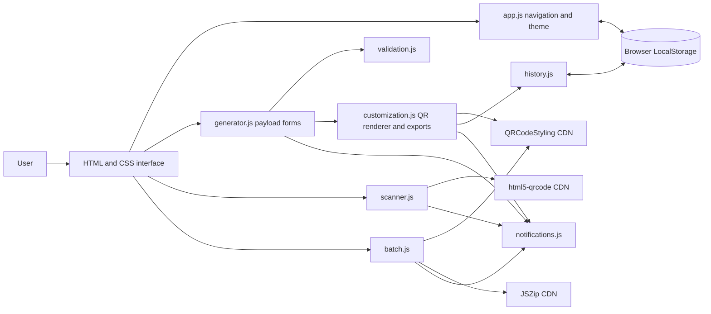
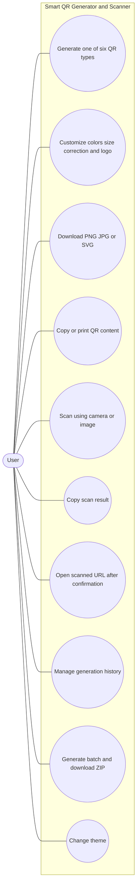
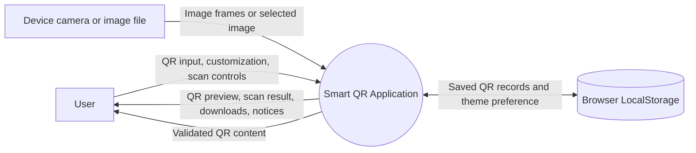
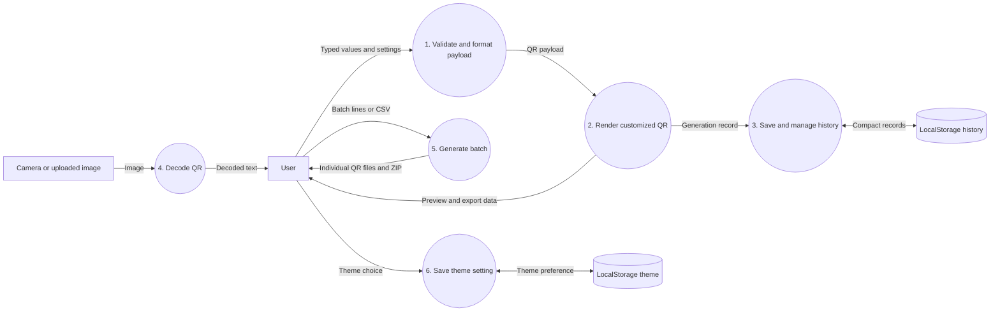
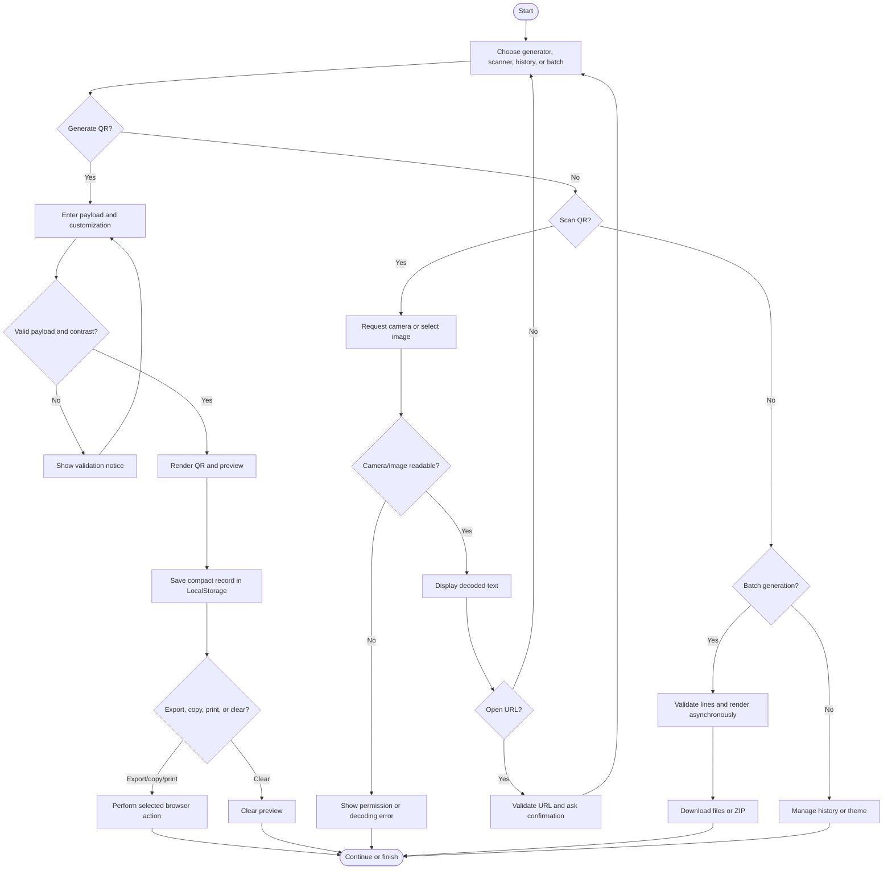
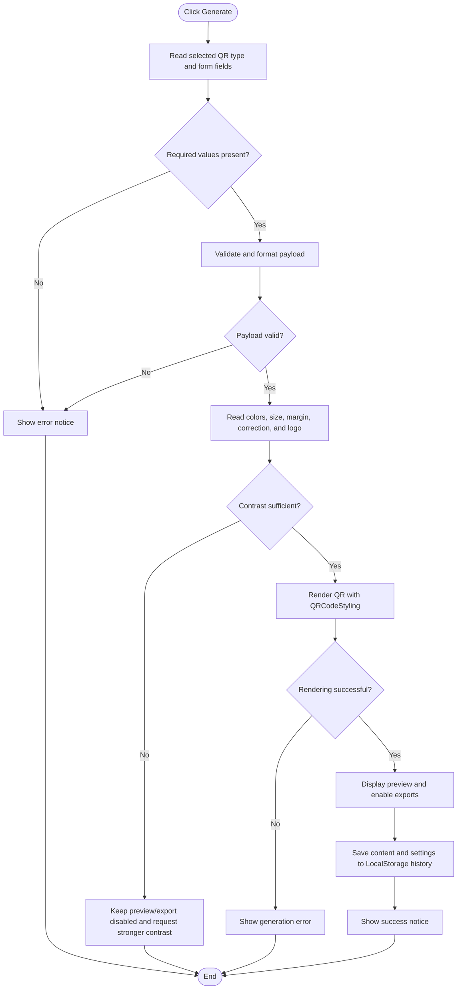

# Smart QR Academic Diagrams

The diagrams use Mermaid. Render them in a Mermaid-compatible Markdown preview or export them to image format for a report.

## System architecture

## Use case diagram

## Data flow diagram — Level 0

## Data flow diagram — Level 1

## Activity diagram

## QR code generation flowchart

